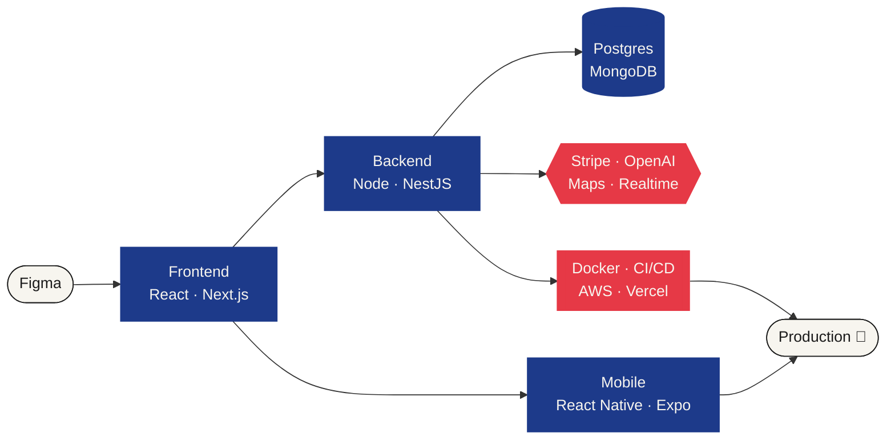

<p align="center">
  
</p>

<p align="center">
  <a href="https://www.linkedin.com/in/nanyn-sviat-dev/"></a>
  <a href="mailto:sviatoslavnanynets@ukr.net"></a>
  
</p>

---

### `> whoami`

Most code dies after demo day. Mine goes to production and stays there.

**6+ years · 10+ products shipped · web + iOS + Android** — SaaS platforms, e-commerce, and business tools that real people use every day. I take a feature from a Figma frame to a live deploy, and I'm just as happy fixing a tangled legacy system as starting a greenfield one.

---

### `> git log --oneline --graph career`

```diff
+ * 2026  (HEAD -> main)  freelance      own the whole lifecycle: client call → prod release
+ * 2023                  senior         system design, Stripe + OpenAI integrations, CI/CD on AWS, code reviews
+ * 2021                  middle         high-traffic apps, real-time features, REST APIs, prod firefighting
+ * 2020                  junior         first commit that reached real users
  * ....                  CS @ Lviv Polytechnic   bachelor → master
```

---

### `> cat pipeline.mmd`



---

### `> ls ./stack`

<p align="center">
  <br/>
  <br/>
  
</p>

<p align="center"><sub>+ React Native & Expo for apps that live on the App Store and Google Play</sub></p>

---

### `> cat hire_me.yaml`

```yaml
roles:      [Senior Full-Stack, Front-End, Mobile Engineer]
format:     remote          # EU / US time zones, async-friendly
strengths:
  - end-to-end ownership    # no micromanagement needed
  - making old systems better, not just building new ones
  - clean, maintainable code that the next dev will thank me for
certs:      [AWS Certified Solutions Architect]
languages:  [English, Ukrainian]
status:     ✅ accepting pull requests (and job offers)
```

---

<p align="center">
  
  
</p>


